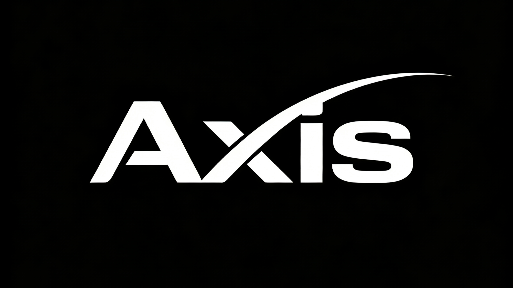

  

# Axis-Evo

Axis-Evo 是一个本地优先的 AI Agent 工作台，面向代码修改、文档交付和需要保留执行证据的任务。选择工作区并描述目标后，Agent 可以在授权范围内检索资料、编辑文件、运行项目检查，并留下可审查的差异与回执。

当前版本为 **0.1.0 Preview（M6.1）**。

## 可以做什么

- **在 Chat 发起任务，在 Work 审查交付。** 查看本轮修改、历史文件版本和验证结果，按已保留的进展继续修订。已授权的知识目录、Skill 库和当前附加的 Edge 页面可以作为任务材料。
- **在实际项目中修改和验证。** Agent 支持受控文件编辑和只读 Git 状态、历史与差异。授权后可在无网络 Linux 容器的项目副本中运行命令和固定检查，实际文件改动通过工作区工具另行保存。
- **核对实际执行结果。** 本地 SQLite 保存任务、工具请求、执行回执和验证记录。文件编辑使用读取时的 SHA-256 校验版本。结果不确定的操作记为 `UNKNOWN`，重启或续跑时不会自动重放。
- **依据任务反馈修订 Skill。** 保留原版和候选版本，用固定案例及历史反例比较实际产物，并按工作区策略决定采用、保留或回退。真实任务中稳定的质量改善和成本收益仍待验证。

## 开始使用

| 场景 | 入口 |
| --- | --- |
| Windows 预览版 | 通过 Setup.exe 安装后，从开始菜单打开 **Axis-Evo**，添加工作区并设置模型。安装包自带 Python 运行时和前端。安装包未签名，构建步骤见 [Windows 预览指南](docs/WINDOWS_PREVIEW.md)。 |
| 源码开发 | 按 [Agent 工作区指南](docs/AGENT_WORKSPACE.md) 构建前端和启动服务。 |
| 配置模型 | 在「模型连接」配置受支持的 Provider。启用外部模型时，完成任务所需的已授权材料会随请求发送给 Provider。见 [模型连接说明](docs/AGENT_PROVIDER.md)。 |

工作台使用本机回环地址。项目命令和固定检查需要 Docker 的 Linux 引擎和用户授权的镜像。Docker 缺失时会禁用这些功能。Edge 扩展为可选组件。

## M6.1 验证记录

- `python-slugify` 的 `--stdin --lines` 任务由 Axis 完成，原项目回归和新增 **8/8** 项固定验收通过。
- `Tomli-W` 的 `sort_keys` 任务在宿主提供诊断后的续跑中由 Axis 写入补丁。独立复验通过原项目回归和新增 **4/4** 项。模型回合因后续请求的预算预留不足而结束。
- 预览安装包已在 Windows 11 验证安装、启动、覆盖安装和卸载。全新 Windows 10/11 环境仍待复验。

模型实跑、确定性回归、安装测试及已知限制见 [测试结果](docs/TEST_RESULTS.md) 和 [Harness 工程基线](docs/HARNESS_ENGINEERING.md)。

## 代码入口

| 路径 | 内容 |
| --- | --- |
| [`src/axis_evo/`](src/axis_evo) | 执行核心、事件、验收、检查点与 Skill 版本 |
| [`web_api/`](web_api) | Agent Runtime、工作区权限、Provider 和容器执行 |
| [`web/`](web) | Chat、Work 和设置界面 |
| [`desktop/windows/`](desktop/windows) | Windows 启动器与安装构建 |
| [`browser/edge-extension/`](browser/edge-extension) | Edge 页面连接 |

## 产品主线与学术归档

产品源码统一维护在 `main`。毕业设计《基于大语言模型的技能演化系统的设计与实现》的公开冻结历史由标签 [`academic/thesis-freeze-2026-11-02`](https://github.com/startuo/Axis-EVO/tree/academic/thesis-freeze-2026-11-02) 保留，也可在工作台的「毕业设计只读展示」查看公开研究记录、评价和证据局限。
