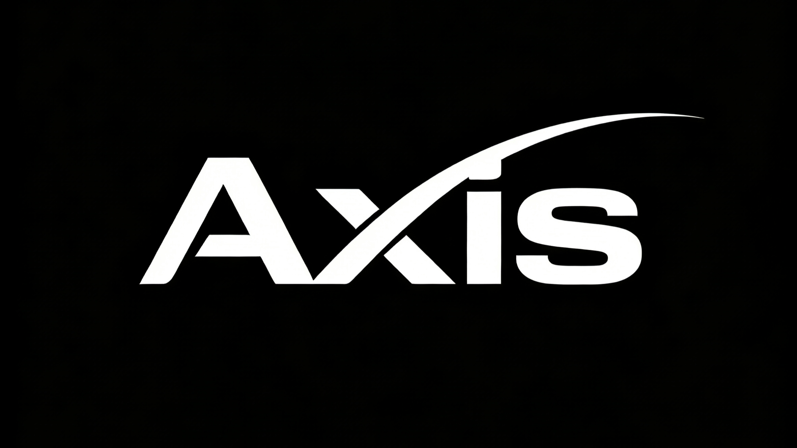

<p align="center">
  
</p>

# Axis-Evo

Axis-Evo 是一个 local-first 的通用 Agent Workbench，支持可核验执行、技能演化和中断审查。

项目将模型规划、调用方审批、工具执行和独立验收分开，通过 SQLite 持久化执行事实，将任务、计划、Skill 版本及执行结果关联起来，并支持只读审查、可核验检查点、受控恢复和证据门控的技能演化。

工作台支持多轮任务、逐轮 Plan 审批、独立 Worker，以及 Skill 修订、配对评估和独立版本激活。不确定执行结果保留为 UNKNOWN。当前版本 **0.1.0 Preview**；产品功能与正式研究实验分别验证。安装与数据维护见 [运行约定](docs/RELEASE_OPERATIONS.md)，演化见 [多代评估](docs/MULTIGENERATION_CAMPAIGNS.md)，验证见 [测试结果](docs/TEST_RESULTS.md)。

## 项目结构

```text
axis-evo/
├── src/axis_evo/
│   ├── models.py / events.py / storage.py   # 数据模型、事件与持久化
│   ├── sandbox.py / tools.py               # 工作区边界与受控工具
│   ├── seed_copy.py / process_limits.py    # 有界复制与子进程资源限制
│   ├── runner.py / validators.py           # 计划执行与独立验收
│   ├── inspector.py                        # 执行事实审查
│   ├── skill_card.py / skill_manager.py     # 不可变技能版本与生命周期
│   ├── skill_binding.py                    # 精确技能版本授权
│   ├── skill_planner.py / planning_*.py     # 模型规划与计划溯源
│   ├── agent_*.py                          # 有界编码尝试与反馈
│   ├── checkpoint_*.py / recovery_*.py      # 检查点与受控恢复
│   ├── skill_trust*.py / shadow_evaluation.py # 证据评估与影子模拟
│   ├── skill_evolution*.py / skill_revision.py # 修订、晋升与版本激活
│   ├── evaluation_campaign*.py              # 显式启用的前瞻配对评估
│   ├── research_*.py                        # 隔离实验、不可变协议与只读导出
│   └── migrations/                        # SQLite 显式迁移
├── examples/                              # 程序化示例与一条命令开发启动器
├── web/                                   # React 工作台、离线演示与样式
├── web_api/                               # 只读桥接、Provider、多轮会话、持久化调度与独立 Worker
├── docs/
│   ├── assets/Axis.png                    # 项目封面
│   ├── SKILL_EVOLUTION.md                  # 技能演化接口与使用说明
│   ├── RECOVERY_OPERATION_CONTRACT.md      # 恢复操作约定
│   ├── WORKBENCH_SETUP.md                  # 工作台启动与当前边界
│   ├── WORKBENCH_UI_SPEC.md                # 界面设计约定
│   └── TEST_RESULTS.md                     # 测试结果
├── pyproject.toml                         # 项目配置
└── AGENTS.md                              # 仓库协作规则
```

会议纪要的执行 Oracle、业务质量与版本采用分别报告。Stage 2D 提供 [独立质量审定](docs/MINUTES_QUALITY.md) 和 [下一轮因果比较协议提案](docs/STAGE2D_RESEARCH_PROTOCOL.md)；现有结果尚未证明 S1 整体改善，人工审定仍待完成，正式 Holdout 与论文主实验未启动。

完整测试、fixture 和交付报告保留在本地审查包中，不随公共仓库发布。
